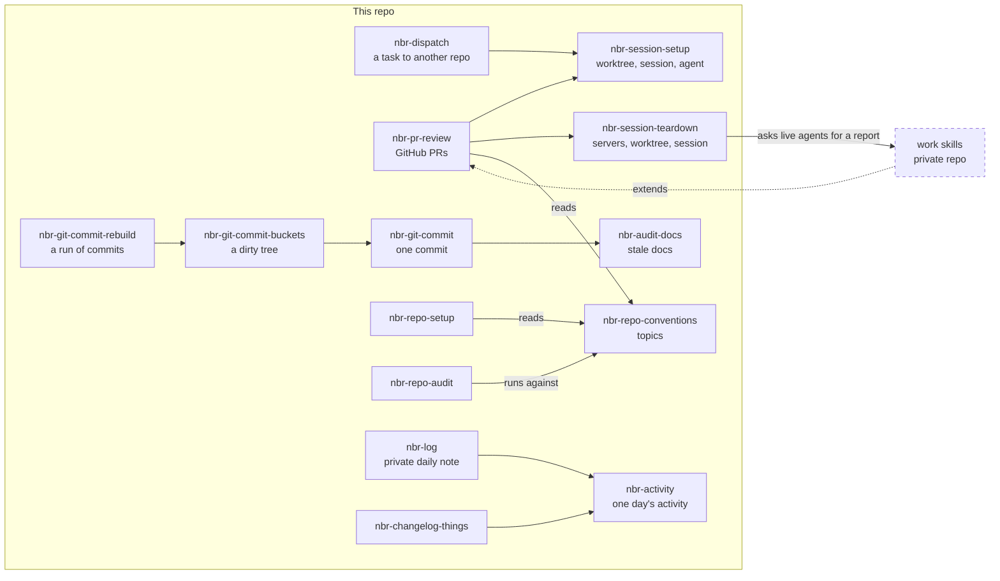

# skills

My agent skills for Claude Code, Pi, Codex and anything else that reads `SKILL.md`. They encode how I plan, commit, open PRs and set up repos, so they are opinionated by design. Take what fits.

## Install

The skills sit in two folders. [`engineering`](skills/engineering) covers coding work and the tools it runs on. [`personal`](skills/personal) covers life outside the code. [Skills](#skills) lists what each one needs installed first.

All of them:

```sh
npx skills add nikbrunner/skills
```

One folder:

```sh
npx skills add https://github.com/nikbrunner/skills/tree/main/skills/engineering
```

One skill:

```sh
npx skills add nikbrunner/skills --skill nbr-git-commit
```

`npx skills add nikbrunner/skills --list` shows everything with its description.

### Working copy

To edit the skills and use them live, clone the repo and link them in:

```sh
git clone https://github.com/nikbrunner/skills ~/repos/nikbrunner/skills
~/repos/nikbrunner/skills/install.sh
```

`install.sh` links every skill folder in `skills/<group>/` into `~/.agents/skills`, and points `~/.claude/skills` and `~/.claude-work/skills` at that directory. It removes links whose skill no longer exists and never replaces a real file or directory. Run it again after adding or removing a skill.

### Third-party skills

The third-party skills I use, including the ones these skills depend on, are recorded in `skills-lock.json`. `install.sh` restores them into `.agents/skills/` (gitignored) and links them next to mine. Manage them from the repo root, then commit the lock:

```sh
npx skills add <source> --skill <name> -a codex   # -a codex installs into .agents/skills
npx skills update -p
npx skills remove <name>
```

## Skills

Each skill names its own requirements in the `compatibility` field of its `SKILL.md`.

### How they work together

Arrows are references written in the skill files. Solid boxes are skills in this repo. The dashed box stands for my work skills, which live in a private repo and build on these.



**A PR review.** `nbr-pr-review` reads the PR, judges its shape and fills a brief, then has `nbr-session-setup` build a worktree on the PR's branch, a Rex session with the Agents, Edit and Shells tabs, and a Claude worker in the Agents tab. The worker reviews against `nbr-repo-conventions`, leaves its report in its pane, and stays for follow-ups. When I'm done, it runs `nbr-session-teardown` on its own session. A work skill runs the same flow for another host, with its own conventions swapped into the brief.

**A dispatch.** `nbr-dispatch` confirms the target repo with me, checks its state, writes the brief with the worker's boundary rules, and launches it through `nbr-session-setup`. The worker reports back to the dispatching session with a handoff.

**A day with Bob.** Bob is my notes session. It keeps the daily notes, takes the reports other sessions send it, and hands out reviews and tasks. For now it lives with my work skills; teardown asks any live agent for its report to Bob before it closes the session.

**The day's record.** `nbr-activity` collects one day's commits and GitHub activity. `nbr-log` writes the private daily note from it, and `nbr-changelog-things` logs it as Things items.

**Commits.** `nbr-git-commit` makes one commit: review, gate, commit, with `nbr-audit-docs` as the docs check. `nbr-git-commit-buckets` sorts a dirty tree into several commits through it, and `nbr-git-commit-rebuild` turns a run of commits back into a dirty tree for buckets.

**Repo conventions.** `nbr-repo-conventions` holds the topics. `nbr-repo-setup` sets a repo up from them and `nbr-repo-audit` checks a repo against them without changing it.

### Engineering

How I plan, commit, open PRs, set up repos and run coding agents.

| Skill                    | What it does                                                                      |
| ------------------------ | --------------------------------------------------------------------------------- |
| `nbr-plan`               | Grill an idea to shared understanding, then write a plan for a PO and a developer |
| `nbr-afk-implementation` | Finish approved implementation work autonomously while you are away               |
| `nbr-git-commit`         | Commit with selective staging, a review pass and an approval gate                 |
| `nbr-git-commit-buckets` | Sort a dirty working tree into atomic commits                                     |
| `nbr-git-commit-rebuild` | Rewrite a run of commits into clean atomic ones                                   |
| `nbr-create-pr`          | Draft and publish a pull request                                                  |
| `nbr-audit-docs`         | Find documentation a diff made stale                                              |
| `nbr-how-to-test`        | Write a black-box acceptance testing checklist                                    |
| `nbr-repo-conventions`   | Conventions for personal projects, by topic                                       |
| `nbr-repo-setup`         | Set up repo tooling from those conventions                                        |
| `nbr-repo-audit`         | Audit a repo against those conventions without changing it                        |
| `nbr-glossary`           | Extract a DDD-style glossary from the conversation                                |
| `nbr-handoff`            | Compact the conversation into a handoff document                                  |
| `nbr-self-reflection`    | Turn a correction into a durable improvement                                      |
| `nbr-slow-mode`          | Slow down for learning and human decisions                                        |
| `nbr-record-clip`        | Record motion as a dark and light looping WebP, or a video with `cap`             |
| `nbr-dispatch`           | Start a coding agent for another repo in a Rex session or Herdr workspace         |
| `nbr-session-setup`      | Set up a worktree, a Rex session or Herdr workspace, and optionally an agent      |
| `nbr-session-teardown`   | Tear a session down without losing unpushed or unreported work                    |
| `nbr-pr-review`          | Review a GitHub PR in a session of its own, against the repo conventions          |
| `nbr-intercom`           | Talk directly to an agent session running in another repo                         |
| `nbr-nvim-dev`           | Neovim and Lua development workflow                                               |

Install these first:

| Dependency                                                          | Install                                                              | Used by                                                    |
| ------------------------------------------------------------------- | -------------------------------------------------------------------- | ---------------------------------------------------------- |
| [`humanizer`](https://github.com/blader/humanizer)                  | `npx skills add blader/humanizer`                                    | `nbr-plan`, `nbr-create-pr`                                |
| [`documentation-writer`](https://github.com/github/awesome-copilot) | `npx skills add github/awesome-copilot --skill documentation-writer` | `nbr-git-commit`, and through it `-buckets` and `-rebuild` |
| [Plannotator](https://github.com/backnotprop/plannotator)           | see its README, it ships `plannotator-annotate`                      | `nbr-plan`                                                 |
| `gh` or [`bkt`](https://github.com/avivsinai/bitbucket-cli)         | your package manager                                                 | `nbr-create-pr`                                            |

`nbr-record-clip` needs ImageMagick, plus VHS, ffmpeg, Playwright or [Cap](https://cap.so) depending on what it records. `nbr-dispatch`, `nbr-session-setup` and `nbr-session-teardown` need [Rex](https://www.superlogical.com/rex) or [Herdr](https://github.com/herdrdev/herdr), `nbr-pr-review` Rex and `gh`, `nbr-intercom` Claude Code, and `nbr-nvim-dev` Neovim and ripgrep.

### Personal

The day's activity and its daily note, tasks in Things 3, and speech from ElevenLabs.

| Skill                  | What it does                                               | Requires                                                                                                        |
| ---------------------- | ---------------------------------------------------------- | --------------------------------------------------------------------------------------------------------------- |
| `nbr-activity`         | Collect one day's commits and GitHub activity              | macOS, git, jq, `gh`                                                                                            |
| `nbr-log`              | Write the day's development work into the private note     | `nbr-activity`, an Obsidian vault                                                                               |
| `nbr-things`           | Manage Things 3 tasks on macOS                             | Things 3, the `things` CLI                                                                                      |
| `nbr-changelog-things` | Log a day's development work as completed Things items     | Things 3, the `things` CLI, `nbr-activity`                                                                      |
| `nbr-tts`              | Turn text into speech with ElevenLabs                      | ElevenLabs account, the `elevenlabs` CLI, jq, ffmpeg, `npx skills add elevenlabs/skills --skill text-to-speech` |

## License

MIT
