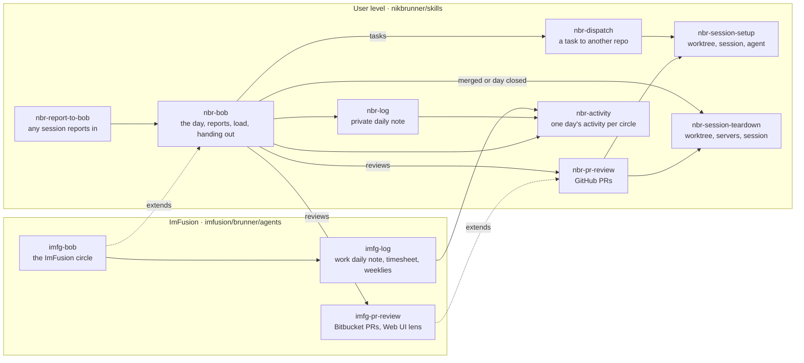

# Session skills, and Bob for everything

Every agent session I start today gets built a little differently: a PR review sets up its own worktree and Rex
session, dispatch has its own way of finding a pane, and cleanup happens by hand. This plan gives sessions one way in
and one way out, and lets the review and dispatch skills use them. It also makes Bob, the notes session, my assistant
for all of my work, private and ImFusion. One Bob keeps one view of my day and my load, with a session of its own:
Bob in the first tab, both daily notes side by side in the second.



| Skill | Lives in | Responsibility |
| --- | --- | --- |
| `nbr-session-setup` | skills | Worktree, dependency install, Rex session or Herdr workspace, optionally an agent in the Agents tab |
| `nbr-session-teardown` | skills | Checks nothing gets lost, stops servers, removes worktree and branch, closes the session |
| `nbr-dispatch` | skills | Confirms the target, writes the brief and boundary rules, launches through setup |
| `nbr-pr-review` | skills | Reads a GitHub PR, judges its shape, briefs a reviewer, launches through setup, cleans up through teardown |
| `imfg-pr-review` | agents | `nbr-pr-review` for Bitbucket: `bkt`, Web UI dev conventions, my frontend lane, the report to Bob |
| `nbr-bob` | skills | Opens and closes the day, files reports, watches my load, hands out work, per circle |
| `imfg-bob` | agents | The ImFusion circle for `nbr-bob`: notes repo, Jira, Bitbucket, timesheet and weeklies through `imfg-log` |
| `nbr-report-to-bob` | skills | Any session, work or private, sends Bob its state |
| `nbr-activity` | skills | Collects one day's activity per circle (git, GitHub, Bitbucket, Jira) as compact text |
| `nbr-log` | skills | Writes the private daily note from `nbr-activity`, as `imfg-log` does for work |

## Decisions

- Setup and teardown are user-level skills, because worktrees, Helm, Rex and Herdr are my tooling everywhere.
- An agent started by setup runs with the launching session's Claude config, because a work session should start work
  agents without a separate rule.
- Agents start in the Agents tab and servers in the Shells tab, as the global AGENTS.md says; a new tab only when the
  session has none.
- `nbr-pr-review` speaks GitHub; `imfg-pr-review` swaps in Bitbucket, because each skill then knows one host.
- One Bob for work and private, running on the work config, because two would split my day and my load.
  Private-config sessions reach it through Rex, which already works.
- Private work goes into the Obsidian vault's daily note, `Log/YYYY/YYYY.MM/YYYY.MM.DD - ddd.md`.
- `bob launch` builds Bob's session with the Rex CLI, because Helm only knows one layout and its panes run no command.

## 1. One way to set up a session

Whoever starts work in another repo, a PR review, a dispatch or Bob, gets the same result: a worktree named by the
convention, a session with the usual tabs, and the agent in the Agents tab on the right account. Nothing appears in a
stray tab.

**Implementation**

- New `skills/engineering/nbr-session-setup/SKILL.md`. Inputs: repo, and a branch, PR source branch or topic; optional
  brief file, agent name, harness.
- Take over from `imfg-pr-review` steps 2 and 3 and from `nbr-dispatch` "Create a worktree", "Check the target
  worktree", "Select the Rex session", "Select the Herdr workspace": reuse a worktree that has the branch (ff when clean),
  else create by the convention; install where the repo says; find the session by label or cwd, else `helm-rex create`.
- Agent launch: first idle `Agent …` pane (`.foreground.name` is a shell), else split one with `--label "Agent <n>"`;
  type `env CLAUDE_CONFIG_DIR=<caller's> claude -n <name> "$(cat <brief>)"` into it, so the brief never passes shell
  quoting. Herdr: the Agents tab, `herdr agent start` + `prompt`.
- Returns worktree path, session, pane, agent name. Never guess an ID; stop on any denial or dialog and report it.
- Verification: set up a throwaway worktree of this repo with a one-line brief; the agent starts in `Agent I` of a new
  session on the work config; a second run reuses worktree and session and lands in `Agent II`.

## 2. One way to tear it down

When work is merged or done, one call clears everything it left: servers, worktree, branch, session. It stops before it
throws away anything not yet pushed or reported.

**Implementation**

- New `skills/engineering/nbr-session-teardown/SKILL.md`. Input: a session or a worktree.
- Stops and reports on: uncommitted changes, commits missing on origin, an agent pane mid-task. A live agent gets asked
  for its report to Bob first.
- Then: Ctrl-C to each busy Shells pane (and `docker compose down` when that pane ran compose), `git worktree remove`,
  `git branch -d` (`-D` only when origin has every commit), `rex kill` the session last, since it may hold the caller.
- Verification: tear down the throwaway from slice 1; a second throwaway with an unpushed commit stops with that commit
  named.

## 3. Dispatch gets thin

Dispatch keeps what makes it dispatch, confirming the target and writing a good brief, and leaves the mechanics to
setup.

**Implementation**

- `nbr-dispatch`: keep the activation contract, target resolution and confirmation, the dirty-state choice, the harness,
  the brief, boundary rules and handoff. Replace the worktree, session, pane and launch sections with a call to
  `nbr-session-setup`.
- Verification: dispatch a trivial task to this repo; it lands in an Agents pane with the brief.

## 4. PR review at user level, ImFusion as a wrapper

A review of one of my GitHub repos works the same way as an ImFusion one. The ImFusion version adds Bitbucket, the Web UI
conventions and my frontend lane on top.

**Implementation**

- New `skills/engineering/nbr-pr-review/SKILL.md`: resolve the PR with `gh pr view`, topic, shape (app, adjacent,
  backend), setup, the brief template against `nbr-repo-conventions`, report shape with TL;DR, offers, stay, teardown
  when done. Never comment, approve or merge unless I say so in that session.
- `imfg-pr-review` shrinks to the wrapper: read with `bkt pr view`, conventions from the `@imfusion/web-ui@dev` copy,
  the frontend-lane rules for comments, `/imfg-report-to-bob` at the end of the brief.
- Verification: Portal #43 (imfusion-portal, CP-228 Labels license key) runs through `imfg-pr-review` today.

## 5. Bob for everything

Bob keeps both days: the ImFusion note and my private one. Reports from any session land in the right one, and Bob still
watches the load across both.

**Implementation**

- New `skills/personal/nbr-bob/SKILL.md` from today's `imfg-bob`: filing rules, open the day, through the day, close the
  day, load, handing out work, circles. The private circle: vault `~/repos/nikbrunner/notes`, note path from
  `.obsidian/daily-notes.json`, template `05 - Meta/Templates/Daily Note`, commit `chore: backup` there too.
- `imfg-bob` keeps the ImFusion circle: notes repo, Jira, Bitbucket, `imfg-log` for note shape, timesheet and weeklies.
- `nbr-report-to-bob` replaces `imfg-report-to-bob`; the report names its circle. The Bob section moves from the
  ImFusion AGENTS.md into the global AGENTS.md. Update links in `~/.agents/skills` (dots) and the agents repo's
  `symlinks.yml`; grep both repos for the old names.
- Verification: a report from a private-config session reaches Bob through Rex and lands in the private note.

## 6. Bob's own session

`bob launch` opens Bob with both notes at hand: the conversation in the first tab, the private and the work daily note
side by side in the second.

**Implementation**

- `bob()` in dots `common/.zshrc`: `rex new Bob` with window `Bob` running `ccw -n Bob "/nbr-bob Good Morning"` in the
  work notes repo; window `Notes` with nvim in the vault, split right with nvim in the work notes repo. Label the panes
  `Bob`, `Private note`, `Work note`.
- Bob opens today's notes in those panes after opening the day (`rex send` `:e <path>`), since they may not exist at
  launch.
- `bob-pane` keeps finding the pane titled Bob; `cmd+b` and `prefix+b` stay.
- Verification: `bob launch` from a fresh shell gives the two tabs; after Bob opens the day both panes show today's
  notes.

## 7. The map in the README

The skills repo shows how its skills fit together, the way the Web UI agent tooling page does: a diagram of who calls
whom, then a table per group with each skill's job. Someone opening the repo, me in three months included, sees the
system before reading a single skill.

**Implementation**

- `README.md`, `## Skills`: a new `### How they work together` before the tables, with the Mermaid flow from this
  plan's top. Solid boxes are skills you run, dashed boxes the ImFusion wrappers that live in the agents repo; a short
  paragraph per path (a day with Bob, a PR review, a dispatch) under it.
- Tables: add `nbr-session-setup`, `nbr-session-teardown`, `nbr-pr-review` to Engineering and `nbr-bob`,
  `nbr-report-to-bob` to Personal, in the existing two- or three-column shape.
- Take over the map from dots `common/.agents/skills/README.md` (`## Map`) where it overlaps, so ROADMAP's "Empty the
  dots skills folder" loses that item; replace this plan's ROADMAP section with a link to this file.
- Verification: the diagram renders on GitHub and in Plannotator; every skill directory under `skills/` appears in a
  table.

## 8. One collector for the day's activity

Bob, the logs and the Things changelog all start from the same question: what did I do on a given day? One skill answers
it for both circles, so none of them collects freeform or guesses my git identity. Builds before slice 5, since Bob's
day rests on it.

**Implementation**

- New `skills/personal/nbr-activity/` with a script: `<script> YYYY-MM-DD [work|private|all]`, plain text on stdout,
  `--json` for scripts. Merge the two existing collectors: `imfg-log/scripts/collect.sh` (git, Jira, Bitbucket) and
  `nbr-changelog-things/scripts/collect-activity.ts` (GitHub).
- Circles, defined once: private = git under `~/repos` minus `~/repos/imfusion`, author `nbr` /
  `nikolaus.brunner@protonmail.ch`, plus GitHub through `gh`; work = git under `~/repos/imfusion` minus the notes repo,
  author `Brunner`, plus Jira through `imfg-atlassian/scripts/atlassian.sh` and Bitbucket through `bkt`. The work sources
  stay in the agents repo; `nbr-activity` calls them when present.
- Output shape (the interface):

  ```text
  # 2026-10-30 · private
  ## git
  helm (black-atom-industries/helm)
    11:35 3f2a9c1 feat(glance): rename the selected workspace in place with Shift-R
  ## github
    black-atom-industries/black-atom #22 Epic: One repo for Black Atom · closed · <url>
  # 2026-10-30 · work
  ## bitbucket
    web-ui #21 <title> · MERGED by brunner · <url>
    imfusion-portal #43 <title> · reviewed by garcia, papanchev · <url>
  ## jira
    WEBSDK-306 <title> · In Progress → Resolved
  ! jira: <reason>
  ```

  One fact per line; a repo heading carries its remote slug once; PR lines name the actor when it is not Nik; `chore:
  backup` commits are dropped; a failed source prints a `!` line and the rest still runs.
- New `skills/personal/nbr-log/SKILL.md`: backfill and write the private daily note (vault path and template from
  `.obsidian/daily-notes.json`), all development work in one `## Development` section before `## Journal`, one bullet per repo in backticks
  (`` - `helm` ``) with its outcomes nested under it, each short enough to read at a glance, ImFusion agent tooling excluded. The rest of the note stays a normal daily note
  for private writing.
- `imfg-log` step 2 and `nbr-changelog-things` read from `nbr-activity` instead of their own collectors; delete those
  once nothing calls them.
- Verification: `<script> 2026-10-25 private` lists the same repos as the backfilled note
  `Log/2026/2026.10/2026.10.25 - Sun.md`; `<script> 2026-10-30 work` shows web-ui #21 merged and labels-web #25 merged.

## Out of scope

- Named layouts in Helm.
- Timesheet or weeklies for the private circle.
